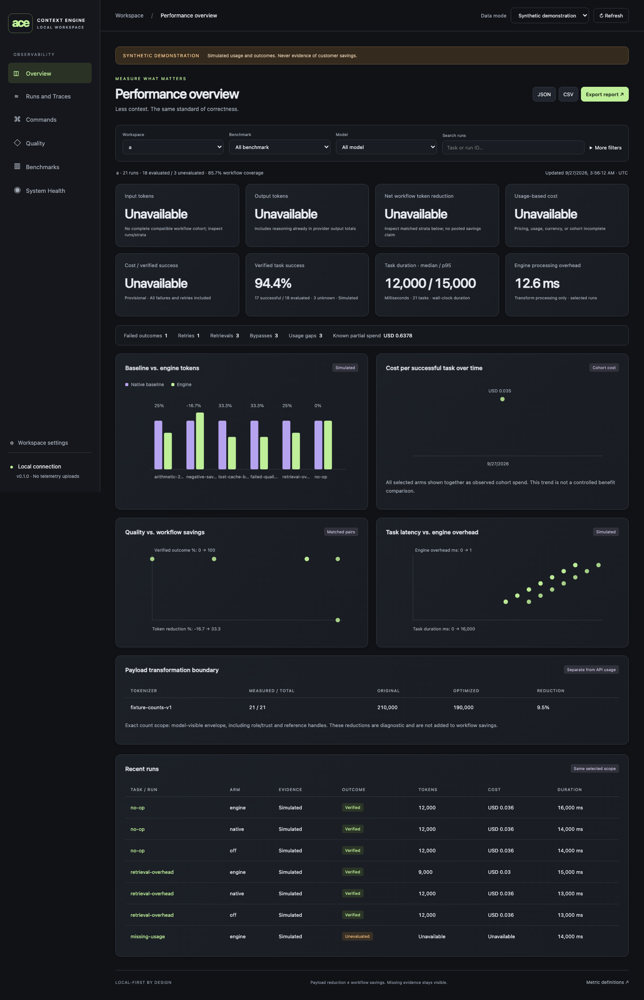

<div align="center">

# Agent Context Engine

### Send less context. Keep exact requirements. Measure the result.

Local-first context optimization and workflow measurement for Python AI agents.

**Python 3.11+ · No required runtime dependencies · CLI + SDK + MCP · Developer preview**

[Quick start](#quick-start) · [Results](#measured-results) · [Python SDK](#python-sdk) · [Documentation](#documentation) · [Contribute](#contributing)

</div>

---

AI agents repeatedly read logs, tool output, and task instructions. That repetition can use up the context window before the useful work is done.

**Agent Context Engine (ACE)** helps developers prepare smaller, structured inputs through deterministic transforms and explicit task scoping. It runs on your computer and includes a dashboard for inspecting token counts, task outcomes, latency, and costs when the required data is available.

**Try it without an API key, GPU, cloud account, or local model.** The included examples and benchmarks run offline after installation and tokenizer preparation.

> **v0.1.0 developer preview.** Local tests and synthetic fixtures are available today. Live model quality, API savings, and production readiness have not been established.

## Why use ACE?

- **Trim repeated tool output.** Encode adjacent identical log lines reversibly and remove JSON whitespace without changing number spelling, key order, or string escapes.
- **Keep task requirements exact.** Select explicit requirement IDs while retaining global constraints and their dependencies.
- **Keep execution under host control.** Expand registered test commands into exact argument lists, with validation and a host approval callback before execution.
- **Inspect the whole workflow.** Track failed tasks, retries, retrieval overhead, cache pricing, and missing usage—not just a smaller input.
- **Start locally.** Use the Python SDK, CLI, or stdio MCP tools. Raw originals stay in memory by default; persistent retention is opt-in.

### A dashboard with inspectable evidence



*This screenshot uses labeled synthetic data. “Unavailable” means the selected runs lack comparable or complete evidence; it does not mean zero cost or zero usage.*

Six views cover **Overview, Runs and Traces, Commands, Quality, Benchmarks, and System Health**. Shared filters also apply to JSON, CSV, and HTML exports. All assets ship with the Python package; no Node.js build is needed.

## Quick start

Download or clone this repository, then open a terminal in its root directory. Requires **Python 3.11 or newer**.

### macOS / Linux

```sh
python3 -m venv .venv
source .venv/bin/activate
python -m pip install -c constraints.txt '.[tokens,dashboard]'
ace tokenizer-prepare
ace offline-agent
ace seed-demo
ace dashboard --port 8767
```

### Windows PowerShell

```powershell
$env:PYTHONUTF8 = "1"
py -3 -m venv .venv
.\.venv\Scripts\python.exe -m pip install -c constraints.txt ".[tokens,dashboard]"
.\.venv\Scripts\ace.exe tokenizer-prepare
.\.venv\Scripts\ace.exe offline-agent
.\.venv\Scripts\ace.exe seed-demo
.\.venv\Scripts\ace.exe dashboard --port 8767
```

1. The offline agent should report `verified_mock_success: true` and `provider_calls: 0`.
2. Open **[http://127.0.0.1:8767/](http://127.0.0.1:8767/)**.
3. Enter the **local login secret printed in your terminal**. Keep that terminal running.
4. Change **Data mode** to **Synthetic demonstration** to explore the seeded dashboard. Real mode remains separate.

Package installation uses the network. `tokenizer-prepare` explicitly downloads a public token vocabulary and verifies its SHA-256. Subsequent offline examples need no connection. The core also works without optional dependencies: install `.` and run `ace diagnostics`. Without the tokenizer and its cached vocabulary, optimization returns unchanged content with an explanation.

**Platform evidence:** tested locally on Apple Silicon macOS, Python 3.14.7, and Chromium. Linux, Windows, and Python 3.11–3.13 have a configured CI matrix; execution of that matrix is pending. See [test results](docs/TEST-RESULTS.md).

## Try it on a real file

After the macOS/Linux quick start, keep the virtual environment active. On Windows, use `.\.venv\Scripts\ace.exe` in place of `ace`.

```sh
# Inspect the local environment and tokenizer availability.
ace diagnostics

# Optimize the included inventory without a selective view.
ace optimize examples/inventory.json --format json --exact-dataset

# Compare original, concise-native, and engine output on offline fixtures.
ace benchmark --repeats 5

# Export one synthetic comparison as a standalone HTML report.
ace report --mode demo --benchmark arithmetic-25-percent --output reports/arithmetic.html
```

The CLI returns JSON containing the content, method, token counts, measurement scope, and any bypass reason. Existing input files are not overwritten.

## Python SDK

Run this after installing the token extra and preparing the tokenizer from the repository root:

```python
from pathlib import Path

from agent_context_engine import Access, Engine
from agent_context_engine.tokens import available
from agent_context_engine.transforms import restore_logs

# Your trusted application creates the workspace access capability.
access = Access("my-agent-host", frozenset({"my-project"}))
engine = Engine(
    "my-project",
    access,
    tokenizer=available(Path(".ace-local/tokenizer")),
)

logs = "worker ready\n" * 200 + "ERROR: validation failed\n"
result = engine.optimize(logs, format="logs")

print(result.method, result.original_tokens, result.optimized_tokens)

# The log representation can reconstruct the exact original text.
if result.method == "adjacent_log_runs":
    assert restore_logs(result.content) == logs

# Pass this envelope to your application's model integration.
# Creating it does not call a model or execute a command.
model_visible_result = result.message()
```

Use `result.message()` for the model-visible envelope. Keep `result.metadata()` for diagnostics; sending that entire object to the model adds accounting overhead. See the [SDK example](examples/sdk_example.py) and [API reference](docs/API.md) for manifests, original retrieval, command registration, and event capture.

## How it works

```text
Your agent or application
         |
         v
Host-selected workspace + explicit requirements / registered tools
         |
         v
Deterministic transform --> validate --> count complete result envelope
         |                                     |
         |                              no benefit / unsupported
         |                                     |
         v                                     v
Smaller result + trust metadata           Original content
         |
         v
Your model integration                  Local metadata events
                                                |
                                                v
                                         SQLite --> dashboard / exports
```

ACE must be connected explicitly to the application that owns the agent loop. Opening the dashboard alone does not intercept other apps or change their model requests. Workflow charts populate from events the host application records; demo mode supplies simulated events for exploration.

| Capability | Current behavior |
|---|---|
| JSON | Remove lexical whitespace; preserve numeric spelling, ordering, and escapes. Duplicate-key input passes through. |
| Logs | Reversibly encode adjacent identical lines, retaining their counts and positions. |
| Pytest output | Remove recognized routine progress rows; retain failure details and final counts, with a reference to the original. Selective views are blocked for exhaustive tasks. |
| Task handoffs | Include explicitly selected requirements, global constraints, and dependency closure without rewriting their text. |
| Commands | Validate a trusted registry and expand exact argument vectors; execution requires host approval. |
| Protected content | Signed content, code, shell, SQL, and other declared protected formats pass through unchanged. |
| No measured benefit | Keep the original when wrapper overhead outweighs the reduction or the tokenizer is unavailable. |

Raw originals are memory-only by default. Persistent originals are optional and plaintext. Metadata lives in local SQLite; choose non-sensitive labels. The dashboard listens on loopback and requires a local session. See [security boundaries](docs/ARCHITECTURE.md) and [security reporting](SECURITY.md).

## Measured results

The included offline benchmark uses **four fixtures × three arms × five repetitions**, with **60/60 deterministic fidelity checks passing**. Token counts below include the inner model-visible tool-result envelope, not a complete provider conversation.

| Fixture | Original tokens | Concise native tokens | ACE tokens |
|---|---:|---:|---:|
| Repetitive coding log with an embedded error | 3,362 | 3,362 | **143** |
| Exact 40-row inventory | 2,314 | 1,663 | 1,663 |
| Already-scoped agent handoff | 530 | 369 | 369 |
| Already compact JSON | 19 | 19 | 19 |

**Repeated logs are the strongest candidate in these fixtures.** For JSON and the handoff, ACE matches the concise native baseline. Already compact JSON stays unchanged. A separate one-call command comparison also selected the native interface because compact-interface definitions cost more tokens.

These measurements establish transform fidelity and local payload size. They do **not** establish live task success, lower provider bills, or faster agent execution. The dashboard’s 25% workflow / 40% main-input example is synthetic test arithmetic, not a product savings claim.

Explore the [methodology](docs/MEASUREMENT.md), [benchmark analysis](docs/BENCHMARK-RESULTS.md), [raw results](reports/offline-benchmark.json), and [test evidence](docs/TEST-RESULTS.md).

## Integrations

| Interface | Status |
|---|---|
| Python SDK and `ace` CLI | Implemented and locally tested |
| stdio MCP server (`ace mcp`) | Protocol and subprocess tests pass; interactive owner-host installation pending |
| Non-streaming Responses adapter | Implemented and mock-tested; live provider validation pending |
| Codex skill/plugin bundle | Included and format-validated; owner-host installation pending |

See [integration instructions](docs/INTEGRATIONS.md). Streaming, additional providers, and transparent interception are not supported in this preview. No live API call is part of the quick start.

## Documentation

| Start here | What you will find |
|---|---|
| [Architecture](docs/ARCHITECTURE.md) | Components, data flow, trust boundaries, and storage |
| [API](docs/API.md) | SDK, CLI-related contracts, and dashboard endpoints |
| [Measurement](docs/MEASUREMENT.md) | Token boundaries, usage revisions, costs, outcomes, and comparisons |
| [Compatibility](docs/COMPATIBILITY.md) | Supported interfaces and unverified environments |
| [Test results](docs/TEST-RESULTS.md) | Executed checks and their limits |
| [Roadmap](docs/ROADMAP.md) | Remaining development and evidence gates |
| [Changelog](CHANGELOG.md) | Release history |
| [Publishing your copy](docs/PUBLISHING.md) | First commit, GitHub setup, and release packaging |

## Troubleshooting

- **“Site cannot be reached”:** run `ace dashboard --port 8767`, keep the terminal open, and use its exact `http://127.0.0.1:PORT/` address. If the port is occupied, choose another, such as `8768`.
- **Empty dashboard:** Real mode starts empty. Run `ace seed-demo` in the same project directory, then select **Synthetic demonstration**.
- **Tokenizer unavailable:** install `.[tokens]` and run `ace tokenizer-prepare` from the same working directory. Unchanged output is the intentional fallback.
- **Certificate error on macOS:** use the official Python installer's `Install Certificates.command` or configure a trusted `SSL_CERT_FILE`. Keep TLS verification enabled.
- **Different workspaces or data directories:** place global flags before the command, for example `ace --workspace my-project --state .ace-local dashboard --port 8767`. Use the same flags when seeding or recording data.

## Contributing

Useful contributions include reproducible workload fixtures, independently validated transforms, platform testing, integration examples, and clearer documentation. **The next major milestone is a spend-capped paired live evaluation runner.** See [the roadmap](docs/ROADMAP.md) before starting larger changes.

For local development, activate your environment, then run:

```sh
python -m pip install -c constraints.txt '.[tokens,dev,dashboard]'
ace tokenizer-prepare
python -m pytest -q
python -m mypy src/agent_context_engine
```

Browser acceptance tests are optional; setup is in [CONTRIBUTING.md](CONTRIBUTING.md). The latest full local run passed **93 tests, including browser checks**. GitHub Actions is configured; this is a local test result, not a hosted CI badge.

When opening an issue, include a small synthetic example, expected behavior, actual behavior, and `ace diagnostics` output with personal paths removed. Never include API keys, login secrets, or private prompts. If ACE is useful to your work, a star or a reproducible use case helps others discover and improve it.

## License and status

Original implementation, with a proposed **[Apache License 2.0](LICENSE)** for the public core. Owner review is pending before public release. Dependencies retain their own licenses; see [third-party notices](THIRD_PARTY_NOTICES.md).

The project and package names are provisional. This is an unpublished developer preview; package installation in this README uses the local source checkout. See [current status](docs/STATUS.md) for the complete delivery scope.
